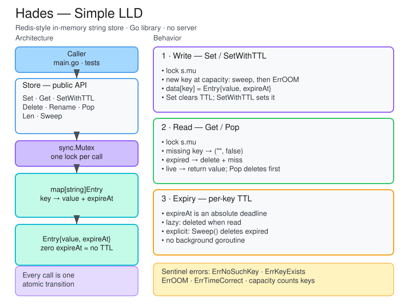

<div align="center">

# Hades

**A thread-safe, Redis-style string store — built from scratch in Go.**


In-memory keyspace · per-key TTL · atomic rename · hard key limit

The data layer of Redis, not the server. Nothing here listens on a port.

</div>

---

## Features

- **String keyspace** — `Set`, `Get`, `Delete`, `Pop`, `Rename`, `Len`.
- **Per-key TTL** — absolute deadlines, lazy delete-on-read, explicit `Sweep`.
- **Bounded capacity** — optional key-count limit; expiring keys can free a slot before `ErrOOM`.
- **Single mutex** — every public method is one atomic transition.
- **Deterministic tests** — 13 test functions, injected clock, zero `time.Sleep`, race-detector clean.
- **Benchmarks** — hot paths, lock contention, and the O(n) worst cases.

## Low-level design



Editable source: [`hades-lld.excalidraw`](hades-lld.excalidraw).

## Quick start

Requires **Go 1.27+**.

```sh
git clone https://github.com/alok-mishra143/hades.git
cd hades

make test     # verbose test suite
make race     # tests under the race detector
make bench    # benchmarks with allocation stats
make build    # → bin/hades
```

## Usage

`internal/store` is deliberately importable only from inside this module.

```go
s := store.NewStore(1_000) // max keys; omit the argument for unlimited

s.Set("user:1", "alok")
v, ok := s.Get("user:1") // "alok", true

s.SetWithTTL("session:1", "abc", 30*time.Second)
// 30s later: "", false — reclaimed on read

s.Sweep() // or reclaim expired keys explicitly
```

### API

| Method | Behavior |
| :-- | :-- |
| `NewStore(maxSize ...int)` | New store. No argument or a negative value means unlimited; `0` rejects every new key. |
| `Set(k, v)` | Insert or overwrite; clears any TTL. `ErrOOM` if a new key would exceed `maxSize`. |
| `Get(k)` | `(value, true)` or `("", false)`. Expired entries are deleted as they are read. |
| `SetWithTTL(k, v, ttl)` | `Set` plus an absolute deadline. `ttl <= 0` returns `ErrTimeCorrect`. |
| `Delete(k)` | Remove a key; deleting a missing key is a no-op. |
| `Rename(old, new)` | Atomic move that preserves the TTL. `ErrNoSuchKey` or `ErrKeyExists`. |
| `Pop(k)` | Return and delete in one critical section. |
| `Len()` | Count live keys without reclaiming expired ones. |
| `Sweep()` | Delete every expired entry; returns how many were removed. |

All errors are sentinels — compare with `errors.Is`.

## Benchmarks

```sh
go test ./internal/store -run '^$' -bench . -benchmem -count=5
```

Apple M5 · Go 1.27.0 · 10,000-key working set · median of 5 runs.

| Benchmark | ns/op | ops/sec | B/op | allocs/op |
| :-- | ---: | ---: | ---: | ---: |
| `BenchmarkStore_Set` | 13.53 | 73.9M | 0 | 0 |
| `BenchmarkStore_GetHit` | 34.60 | 28.9M | 0 | 0 |
| `BenchmarkStore_GetMiss` | 10.61 | 94.3M | 0 | 0 |
| `BenchmarkStore_SetGet` | 45.17 | 22.1M | 0 | 0 |
| `BenchmarkStore_SetWithTTL` | 39.86 | 25.1M | 0 | 0 |
| `BenchmarkStore_ParallelGet` | 154.80 | 6.46M | 0 | 0 |
| `BenchmarkStore_ParallelSet` | 138.80 | 7.20M | 2 | 0.00 |
| `BenchmarkStore_SweepLive100k` | 441,365 | 2,266 | 0 | 0 |
| `BenchmarkStore_SetFull` | 49,012 | 20,403 | 0 | 0 |

- **Fast on one goroutine** — 74M sets/s and 29M gets/s, with zero allocations.
- **Contention is the ceiling** — 10 workers aggregate only 6.5M gets/s and 7.2M sets/s.
- **O(n) paths dominate** — a 100k-key sweep takes ~441 µs; a rejected write ~49 µs.

> These are engine numbers. There is no socket, protocol parsing, or syscall in the
> path — a real Redis comparison would be dominated by the network round trip.

## Design decisions

| Decision | Rationale |
| :-- | :-- |
| **One `sync.Mutex`** | `Get` deletes expired entries, so reads need the write lock; an `RWMutex` would buy nothing. |
| **Public methods own the lock** | `*Locked` helpers assume it. The mutex isn't reentrant, so `Rename` runs its checks and move in one critical section. |
| **Delete-on-read expiry** | `Get`/`Pop` reclaim what they touch; `Len`/`keys` filter without mutating; `Sweep` handles the rest. |
| **Capacity is a safety valve** | At `maxSize`, a new key triggers one sweep; live keys are never evicted and overwrites are always allowed. |
| **Injected clock** | `now func() time.Time` lets tests cross expiry boundaries without sleeping. |

## Project layout

```text
.
├── cmd/hades/main.go        # demo only — no listener
├── internal/store/
│   ├── store.go             # Store, Entry, core keyspace
│   ├── expiry.go            # TTL writes and Sweep
│   ├── errors.go            # sentinel errors
│   ├── store_test.go        # keyspace tests
│   ├── expiry_test.go       # TTL and sweep tests
│   ├── rename_test.go       # rename semantics
│   ├── capacity_test.go     # capacity and OOM
│   └── bench_test.go        # 9 benchmarks
├── hades-lld.excalidraw     # editable low-level design
├── hades-lld.svg            # rendered design for README
├── makefile
├── go.mod
└── README.md
```

## Out of scope

- **No server.** No RESP parser, TCP listener, or command dispatch — planned, deliberately never written.
- **Strings only.** No lists, hashes, sets, or sorted sets.
- **No background expiry.** Unread TTL'd keys stay resident until `Sweep` or the OOM path runs.
- **No persistence, transactions, pub/sub, replication, auth, or clustering.**
- **`Rename` differs from Redis.** A live destination returns `ErrKeyExists` instead of being overwritten; the source TTL is preserved.
- **Capacity counts keys, not bytes.** There is no `maxmemory` and no eviction policy.

---

<div align="center">
<sub>Built as a deliberate-practice exercise: test-first, one milestone at a time.</sub>
</div>
